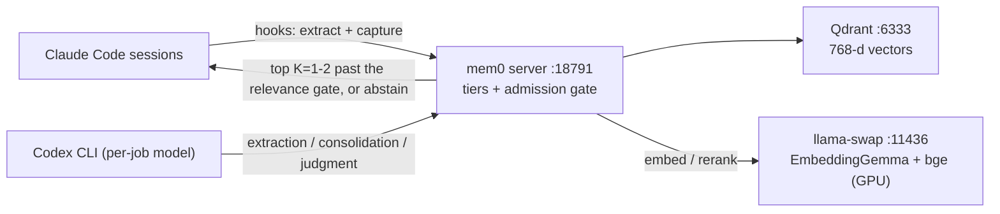

# Agentic Memory Stack for Claude Code

[](https://github.com/dmmdea/agentic-memory-stack-for-claude-code/actions/workflows/ci.yml)

A persistent, multi-tier, **measurably faithful** memory backend for [Claude Code](https://docs.claude.com/en/docs/claude-code): one always-on **authority** holds the memory, and any number of Windows + WSL2 or Linux PCs use it. It captures durable facts from your sessions, consolidates them into higher-order insights, surfaces the right one before each prompt, and governs against drift — with a causal-intervention eval proving the memory actually changes behavior.

> **What it is:** semantic memory (mem0 + Qdrant + EmbeddingGemma), background extraction (Codex CLI), one 18-step nightly chain on the native-Linux authority (consolidation, dedup, backups, health), tiered trust (evidence → insight → canonical), an episodic/goals/open-questions sidecar, and a canonical-key credential kept out of the store (a systemd credential on the native authority, a DPAPI blob on a Windows-hosted authority).
>
> **What it is NOT:** a Claude Code feature. It's external infrastructure: one authority (a Linux box, or a Windows PC with WSL2 that is its own authority) plus a PC install on each machine you code on.

## What you get

- **Zero-effort capture** — facts are extracted from your sessions automatically (session end, compaction, nightly consolidation), behind an inferability gate that keeps generic noise out and a redaction chokepoint that keeps credentials out.
- **Right memory, right moment** — the top 1–2 relevant memories are injected above each prompt (or *nothing*, if nothing clears the calibrated relevance gate); `memory_recall` / `memory_search` MCP tools for deeper, deliberate pulls on top of that injection; a resume précis at session start.
- **Trust, not just recall** — five tiers from auto-captured `evidence` up to HMAC-locked `canonical` ground truth; an admission gate hides superseded, contradicted, or wrong-workspace records at read time; time-sensitive tiers age out on a Weibull curve.
- **A memory that polices itself** — weekly Codex-judged contradiction sweeps, an on-demand supersession sweep, an optional write-time NLI gate, and a queue-gated resolution policy: false flags auto-clear, evidence-vs-evidence hides are human-confirmed, and every hide is one-command reversible and forensically visible.
- **Boring-by-design operations** — nightly/weekly hygiene run as one receipted chain (dedup, decay, backups ×8 with integrity checks; the L10 audit runs on its own 6-hour timer), an append-only audit ledger, a private-network-only bind + API-key security, and a full MCP tool family (memory, episodic, goals, open questions).



## Documentation

| You want to… | Read |
|---|---|
| Understand how it all works | **[ARCHITECTURE.md](./ARCHITECTURE.md)** — layers, tiers, data flow, invariants, design decisions |
| Install it | this README (below) + [the installer skill](./skill/install-agentic-memory-stack/SKILL.md) + [llama-swap setup](./install/llama-swap-setup.md) |
| Operate / debug it | [docs/operations.md](./docs/operations.md) — symptom → fix, schedules, the review queue |
| Keys and credentials | [docs/systems/key-custody.md](./docs/systems/key-custody.md) |
| Move to a new machine | [docs/MIGRATION.md](./docs/MIGRATION.md) — keep your memory; code fresh, data restored, keys re-provisioned |
| Change the stack itself | [CONTRIBUTING.md](./CONTRIBUTING.md) and [docs/DEVELOPMENT.md](./docs/DEVELOPMENT.md) — repo tour, tests, the deploy path, release ritual |
| Report a vulnerability | [SECURITY.md](./SECURITY.md) |
| Call its API / tools | [docs/api-contracts.md](./docs/api-contracts.md) — the REST + MCP contract |
| Everything else | **[docs/README.md](./docs/README.md)** — the full documentation map |

## 1. Choose your topology

The installer you run decides the topology. In every one, mem0 + Qdrant + llama-swap run on exactly one machine, the **authority** (the installer role called `brain` is an authority). Every other machine is a **replica** or a **client** of it.

| | Topology | Machines | Install | Network |
|---|---|---|---|---|
| **a** | **One Windows PC with WSL2** — everything local. The default `install.ps1` role. | 1 | `pwsh -File .\install.ps1` | none: mem0 binds loopback (`http://127.0.0.1:18791`), no Tailscale |
| **b** | **A Linux authority plus Windows and/or Linux PCs** | 1 authority + N PCs | `bash install/linux-authority.sh ...` on the authority, then `install.ps1 -Role replica ...` (Windows) or `install/linux-client.sh` (Linux) on each PC | a private network both can reach, such as [Tailscale](https://tailscale.com); the authority binds that network's address, never `0.0.0.0` |
| **c** | **A Linux box with no Windows** | 1 client | `bash install/linux-client.sh ...` against an authority from (b) | same as (b) |

Topology (c) is a thin client, not a stand-alone stack. What it installs, from `install/linux-client.sh`:

- the `mem0` MCP server (the shim) and the outbox: while the authority is unreachable, reads return an offline result and writes queue to `~/.mem0/outbox.jsonl` and replay later;
- capture hooks (Stop, PreCompact, SessionStart), but only when `pwsh` 7 and a logged-in `codex` are present; without them the step is skipped with a message;
- the fleet-store hooks, only with `--ams-hub`.

It does **not** install the per-prompt `[MEMORY CONTEXT]` injection (no `UserPromptSubmit` hook is registered on Linux), the nightly dream, or a local store. `install/linux-replica.sh` adds a dormant read-only copy for offline use on top of it. The authority install (`linux-authority.sh`) sets up the server only: it registers no hooks and no MCP server on its own box. To use the memory from the authority box itself, run the client installer there too ([docs/operations.md](./docs/operations.md), "a local client on the native Linux authority").

Terms: a **tenant** is the `user_id` the memory is stored under; the **authority** is what some docs and installer flags call the *brain*.

## 2. Prerequisites

**Every machine that runs the Windows installer (topologies a and b-PC):**

| Component | Why |
|---|---|
| Windows 10+/11 with **PowerShell 7** (`pwsh`) | The installer refuses Windows PowerShell 5.1 (the deployed hooks still run under it). Install: `winget install --id Microsoft.PowerShell` |
| **WSL2** with a Linux distro, `mirrored` networking, systemd enabled | mem0/Qdrant (or the replica's dormant copy) run here. `%USERPROFILE%\.wslconfig`: `[wsl2]` `networkingMode=mirrored`; `/etc/wsl.conf`: `[boot]` `systemd=true`; then `wsl --shutdown` |
| **Python 3.12+** in WSL (`python3`), `curl`, `jq`, Node.js 22+ | Ubuntu 24.04 ships 3.12 (`wsl --install -d Ubuntu-24.04`); Ubuntu 22.04's `python3` is 3.10 and fails the check |
| [Claude Code](https://docs.claude.com/en/docs/claude-code) | The host you are augmenting |
| [Codex CLI](https://github.com/openai/codex) from npm (`npm i -g @openai/codex`), logged in with **Sign in with ChatGPT** | Background extraction and consolidation. The installer wants the npm shim at `%USERPROFILE%\AppData\Roaming\npm\codex.cmd` and a ChatGPT-subscription login; an API-key login is not accepted |
| `git` 2.38+ for Windows | The store binary merges with `git merge-tree` |
| **llama-swap** serving the embedder and the reranker on `127.0.0.1:11436`, on a GPU | Set it up **before** the installer: [install/llama-swap-setup.md](./install/llama-swap-setup.md). The default embedding profile is `egemma2` (EmbeddingGemma-2, needs llama.cpp **b11452 or later**) plus bge-reranker-v2-m3. A replica (b) needs it too, for its dormant copy |

A Claude subscription login (`~\.claude\.credentials.json`) is reported but not required.

**Topology (b) adds:** Tailscale (or another private network) on the authority and on each PC, so the PC can open `http://<authority-host>:18791`. With WSL `mirrored` networking, WSL uses the Windows host's network, so Tailscale runs on the Windows side only. Without Tailscale, bind the authority to a private LAN address and pass that address as `--bind-ip`; the traffic is plain HTTP plus an API key, so keep it on a network you trust.

**A native Linux authority also needs:** an x86_64 Linux box with systemd **256 or later** and a **TPM2** (the installer encrypts the key credentials with `systemd-creds --with-key=host+tpm2`; without a TPM the installer cannot create them), a non-root service user (`sudo loginctl enable-linger <user>` once; the installer tries it), `python3 curl jq iproute2`, `tailscaled` up, llama-swap as above, and, for the nightly dream, Node plus the Codex CLI logged in (the installer warns when either is missing). Python 3.12 comes from `uv`: if `uv` is absent the installer fetches it with `curl -LsSf https://astral.sh/uv/install.sh | sh` into `~/.local/bin`; install `uv` first to skip that download. Optional steps (cloud mirror, RTC wake, store hub, wiki index) are left out of the nightly chain unless configured, and the ZFS replication step skips itself until you provide its script.

## 3. Install

Clone the repository first; the installer reads everything from the checkout. Run it from PowerShell 7:

```powershell
git clone https://github.com/dmmdea/agentic-memory-stack-for-claude-code $HOME\agentic-memory-stack
cd $HOME\agentic-memory-stack
```

A repository downloaded as a zip carries the Windows internet-zone mark. Either run `Get-ChildItem -Recurse | Unblock-File` once, or start the installer as `pwsh -ExecutionPolicy Bypass -File .\install.ps1`. The 4-phase installer (`prereqs → WSL services → Windows config → verify`) stops with an exact fix when a prerequisite is missing and is safe to re-run.

### a. One Windows PC (everything local)

```powershell
pwsh -File .\install.ps1                    # detects your default WSL distro
pwsh -File .\install.ps1 -Distro <distro>   # multi-distro; see: wsl -l -q
```

No flags: the first install takes the role `brain` (this PC is its own authority, mem0 on loopback). It registers the nightly dream (03:00) and dedup (04:30) scheduled tasks. A re-run keeps the recorded role.

### b. A Linux authority plus PCs

**1. On the authority**, once, as the service user. Make the two key credentials. Write the plaintext to a scratch directory, encrypt, and keep the plaintext of both keys somewhere safe **off this box** (every PC needs the API key; the canonical key cannot be regenerated, because canonical records are signed with it):

```bash
mkdir -m 700 -p <secrets-dir> && cd "$(mktemp -d -p "${XDG_RUNTIME_DIR:-/dev/shm}")"   # memory-backed scratch: never write the keys into the checkout
umask 077
python3 -c 'import secrets; print(secrets.token_urlsafe(32))' > ams-api-key.txt
python3 -c 'import secrets; print(secrets.token_urlsafe(32))' > ams-canonical-key.txt
systemd-creds --user encrypt --with-key=host+tpm2 --name=ams-api-key       ams-api-key.txt       <secrets-dir>/ams-api-key.cred
systemd-creds --user encrypt --with-key=host+tpm2 --name=ams-canonical-key ams-canonical-key.txt <secrets-dir>/ams-canonical-key.cred
# copy both .txt files to your password manager or other off-box store, then:
shred -u ams-api-key.txt ams-canonical-key.txt
```

Keep `--name=`: without it decryption under the credential's id fails. The installer creates the third credential, the service key, itself. Details: [docs/systems/key-custody.md](./docs/systems/key-custody.md).

Log the authority's Codex in (the nightly dream and the contradiction sweep use it; the installer warns if it is missing):

```bash
npm i -g @openai/codex
mkdir -p <secrets-dir>/codex && CODEX_HOME=<secrets-dir>/codex codex login    # Sign in with ChatGPT
```

Serve the embedder and reranker with llama-swap ([setup](./install/llama-swap-setup.md)), then install. `tailscale ip -4` prints the address for `--bind-ip`:

```bash
git clone https://github.com/dmmdea/agentic-memory-stack-for-claude-code ~/agentic-memory-stack && cd ~/agentic-memory-stack
bash install/linux-authority.sh --bind-ip "$(tailscale ip -4)" --secrets-dir <secrets-dir> --user-id <tenant> --dry-run   # review the plan
bash install/linux-authority.sh --bind-ip "$(tailscale ip -4)" --secrets-dir <secrets-dir> --user-id <tenant>
```

`~/apps/mem0-server`, `~/apps/mem0-scripts`, `~/qdrant-server` and `~/.mem0` may be symlinks into a data volume. If they are plain directories (or absent) the installer says so and keeps the data on the root disk. A re-run inherits every optional flag recorded in `~/.mem0/stack.env`. `bash install/linux-authority.sh --help` lists them all.

**The tenant rule.** `--user-id` is the tenant the authority stores memory under. Each Windows PC derives its tenant from its WSL user name (`wsl -d <distro> -e whoami`). The two must be equal. A mismatch gives no error, only a second, empty memory under another name. `install.ps1` has no tenant flag, so set `--user-id` to the WSL user name of your Windows PCs, and create the WSL user with that name on each one. The Linux client takes the tenant as `--user-id <tenant>`.

**2. On each Windows PC.** The PC needs the authority's API key; the installer does not fetch it. On the authority, `systemd-creds --user decrypt --name=ams-api-key <secrets-dir>/ams-api-key.cred -` prints it. Put it alone on one line in a file on the PC, then:

```powershell
pwsh -File .\install.ps1 -Role replica -AuthorityUrl http://<authority-host>:18791 -ApiKeyFile <path-to-key-file> [-AuthoritySsh <ssh-alias>]
Remove-Item <path-to-key-file>
```

`-ApiKeyFile` is replica-only; it is written to `~/.mem0/api-key` in WSL (mode 600) before the WSL phase. `-AuthoritySsh` is the ssh alias of the authority as WSL knows it, used to forward `canonize` commands. A re-run keeps the recorded role, URL and key. A replica also registers two scheduled tasks, `mem0-offline-watcher` and `mem0-replica-cache-refresh`, so it can take over with a local read-only copy when the authority is unreachable; the copy is seeded from the authority's newest backup set in the cloud-sync folder the authority mirrors to (`--pcloud-dir`). Without such a mirror the PC works while the authority answers but cannot take over offline.

Other `install.ps1` flags (re-runs inherit the recorded values): `-HubHost` (store hub, MagicDNS name), `-BinaryPath` and `-BinarySums` (an offline `ams-store.exe` and its `SHA256SUMS`; otherwise phase 2 downloads the release asset from GitHub and fails without network), `-ReleaseRepo` (a fork's `<owner>/<repo>`), `-EmbedProfile`, `-MediaEmbedder`, `-LogFile`, `-NonInteractive`.

**Linux PC:** `bash install/linux-client.sh --authority http://<authority-host>:18791 --api-key-file <file holding the key> --user-id <tenant>`. Details: [docs/systems/installer-and-deploy.md](./docs/systems/installer-and-deploy.md).

### c. A Linux box with no Windows

Same as the Linux PC line above. The box needs Python 3.12+ and Claude Code; add `pwsh` 7 and the Codex CLI to get the capture hooks.

## 4. Check it worked

**Authority.** The installer ends by probing the server and fails if it is not healthy. By hand:

```bash
curl -s http://<authority-host>:18791/health/deep | jq '{ok, collection, embed_profile: .embed_profile.profile, canonical_key: .checks.canonical_key, service_key: .checks.service_key, embedder: .checks.embedder}'
systemctl --user list-timers ams-nightly.timer l10-audit.timer
```

Green is `"ok": true`, `"collection": "mem0_eg2_768"` with `"embed_profile": "egemma2"` on the default profile, `canonical_key` and `service_key` present, and `embedder.ok: true`. An empty store is expected on a first install. `/health`, `/health/deep` and the other health probes need no key; everything else needs the `X-API-Key` header.

**Each Windows PC.** `install.ps1` runs `install\3-verify.ps1` last and ends with `ALL VERIFY CHECKS PASSED.` On any failure it prints `VERIFY FAILED`, lists each failed check with its fix, shows a red `INSTALL INCOMPLETE` and exits 1; fix the item and re-run. An HTTP 401 on a replica means the authority's key is not in `~/.mem0/api-key`: re-run with `-ApiKeyFile`. Then restart Claude Code and confirm:

```powershell
claude mcp list                                   # mem0 listed and connected
& "$env:USERPROFILE\.claude\scripts\Test-MemoryStack.ps1"   # Memory stack: HEALTHY (3/3 dimensions GREEN)
```

In a Claude Code session, `memory_add` a fact, then `memory_search` for it. To prove the fleet works, add one on one PC and search for it from another.

## 5. Upgrade

```powershell
git pull
pwsh -File .\install.ps1                          # a PC: re-runs keep the recorded role and flags
```

```bash
git pull   # or extract the release archive of the tag you want
bash install/linux-authority.sh --bind-ip <MEM0_BIND> --secrets-dir <MEM0_SECRETS_DIR>   # both values are in ~/.mem0/stack.env
```

Release notes are on this repository's GitHub Releases page; [CHANGELOG.md](./CHANGELOG.md) has the full history. Rolling back is the same command from the previous tag's tree.

## 6. Uninstall / roll back

The installers make backups of the files they edit: `<file>.bak-<yyyyMMddHHmmss>-pre-ams-install` beside `~\.claude\settings.json`, `~\.claude.json` and `~\.claude\CLAUDE.md`. The oldest one is the state before the first install. Remove from the outside in:

**Windows PC** (PowerShell 7):

```powershell
# 1. scheduled tasks (brain: the first two; replica: the last two)
'ClaudeCode-DreamConsolidator-3am','ClaudeCode-SemanticDedup-430am','mem0-offline-watcher','mem0-replica-cache-refresh' |
  ForEach-Object { Unregister-ScheduledTask -TaskName $_ -Confirm:$false -ErrorAction SilentlyContinue }
# 2. the MCP server
claude mcp remove mem0 -s user          # or delete mcpServers.mem0 from ~\.claude.json
```

3. In `~\.claude\settings.json` delete the hook entries whose command names one of `stop-extract.ps1`, `precompact_capture.py`, `storage-cap-check.sh`, `mem0-hook-daemon-spawn.ps1`, `codex-shim-spawn.ps1`, `sessionstart-capture.ps1`, `memory-maintenance-spawn.ps1`, `mem0-hook-client.exe` or `ams-store.exe`, and `env.ENABLE_TOOL_SEARCH` if you did not have it before. To undo everything at once, copy the oldest `settings.json.bak-*-pre-ams-install` back (this also drops any edit made since).
4. In `~\.claude\CLAUDE.md` delete the section that starts `## Memory tier protocol (agentic-memory-stack)`.
5. Delete the deployed copies in `~\.claude\scripts` (the files that share a name with the ones under the repo's `scripts/windows/`, plus `mem0-mcp-shim.py`, `ams-store.exe` and `mem0-stack.config.psd1`) and `%USERPROFILE%\.mem0` (the `role` and `authority-url` mirrors). If you used `-HubHost`, remove the block between `# >>> ams-store hub` and `# <<< ams-store hub` in `~\.ssh\config`.

**WSL side** (the same on a brain and a replica; these commands run inside the distro):

```bash
systemctl --user disable --now mem0.service qdrant.service l10-audit.timer decay-scan.timer stack-backup.timer \
  goals-stale-sweep.timer contradiction-sweep.timer retrieval-pairs.timer episodic-reconcile.timer goal-recurrence-promote.timer
cd ~/.config/systemd/user && rm -f mem0.service qdrant.service {l10-audit,decay-scan,stack-backup,goals-stale-sweep,contradiction-sweep,retrieval-pairs,episodic-reconcile,goal-recurrence-promote,egemma-rollback-prune}.{service,timer}
systemctl --user daemon-reload
```

**Native authority:**

```bash
systemctl --user disable --now ams-nightly.timer l10-audit.timer mem0.service qdrant.service
for u in ~/.config/systemd/user/ams-step-*.service; do systemctl --user disable "$(basename "$u")"; done
cd ~/.config/systemd/user && rm -rf ams-* mem0.service mem0.service.d qdrant.service l10-audit.* l10-audit.service.d
systemctl --user daemon-reload
sudo systemctl disable --now ams-nft.service; sudo rm -f /etc/systemd/system/ams-nft.service   # only if you installed the nft belt
```

**What is kept.** None of the above touches your memory or your keys. The data lives in `~/.mem0` (receipts, ledgers, `episodic.db`, backups, `stack.env`), `~/qdrant-server` (the Qdrant binary and every vector), `~/apps/mem0-server`, `~/apps/mem0-scripts` and, on the authority, `<secrets-dir>` (the `.cred` files). Deleting these destroys the memory; take a backup first ([docs/data-backup.md](./docs/data-backup.md)). The installers also leave `~/models`, llama-swap, llama.cpp, `uv`, `/usr/local/bin/ams-store` (hub installs) and the systemd linger setting in place.

## Why Codex (and not Claude) as the subagent?

Claude Max OAuth enforces a single concurrent session — headless `claude --print` from hooks fails intermittently when an interactive session holds the slot (by design; headless agentic workloads are Anthropic's paid-API territory). Codex CLI authenticates via your **ChatGPT subscription** (separate OAuth, no concurrency block) and runs reliably headless from any Windows shell at zero marginal cost; quality matches for structured extraction. **All LLM judgment routes to Codex; local llama-swap models do embedding/reranking only.**

## Architecture

See **[ARCHITECTURE.md](./ARCHITECTURE.md)** for the full data-flow diagram and **[skill/.../references/architecture.md](./skill/install-agentic-memory-stack/references/architecture.md)** for the summary. Live runtime processes on the authority: `mem0-server` (:18791, the private-network address) + Qdrant (:6333, loopback) + llama-swap (:11436, EmbeddingGemma + bge-reranker on the GPU) + the Codex CLI on demand; on every PC, the Claude Code hooks and the MCP shim. Trust tiers: evidence → insight → canonical (HMAC-gated, CLI-only promotion).

### Faithfulness (R1–R6)

The stack went from "store + inject and hope" to "measurably faithful memory": a causal-intervention eval (R1), specificity-first extraction (R3), abstention-first gated injection (R2), write-gate + freshness + reconciliation governance (R5), attention-hygiene placement (R6), and a low-confidence raw-trace fallback (R4). The eval harnesses are not part of this repository; the GitHub Releases pages carry the public notes.

## Files in this repo

| Path | What |
|---|---|
| `install/` + `install.ps1` | The 4-phase idempotent, operator-agnostic PC installer, plus `linux-authority.sh`, `linux-replica.sh` and `linux-client.sh` |
| `scripts/windows/` | PowerShell runtime: hooks, the compiled UserPromptSubmit client, extractor, consolidator, `Test-MemoryStack` |
| `scripts/wsl/` | mem0 MCP shim, audit/decay/dedup/backup/restore/reconcile, canonize CLI, index builder |
| `mem0-server/` | FastAPI wrapper around mem0 (+ episodic/goals/open-questions, admission gate, freshness, NLI write-gate, Codex shim client) |
| `ams-store/` | The Go store client (`ams-store`), released as a binary per tag |
| `systemd/` | systemd-user units (services + timers) |
| `claude-config/` | CLAUDE.md tier-protocol snippet, model-tiers, storage-cap-check, `settings.example.json` |
| `skill/install-agentic-memory-stack/` | The Claude Code installer skill (`SKILL.md` + `references/`) |
| `docs/` | Operations, API contract, per-system and per-flow deep-dives — see [docs/README.md](./docs/README.md) for the map |

## License

Apache-2.0 — see [LICENSE](./LICENSE), [NOTICE](./NOTICE) and [THIRD-PARTY-NOTICES.md](./THIRD-PARTY-NOTICES.md). The release binaries embed third-party Go code; the installers also download third-party software and model weights under their own licenses, listed in `THIRD-PARTY-NOTICES.md`.
